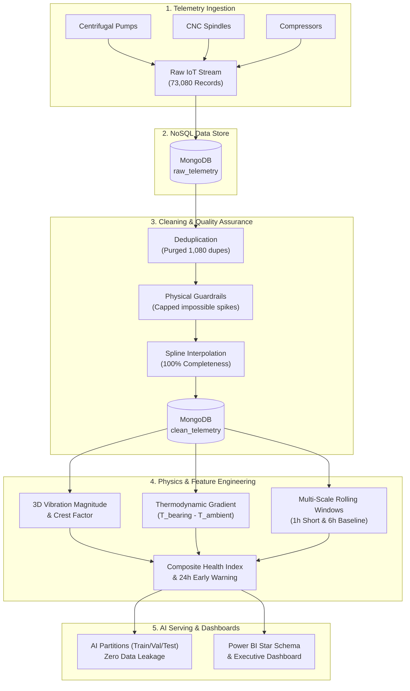
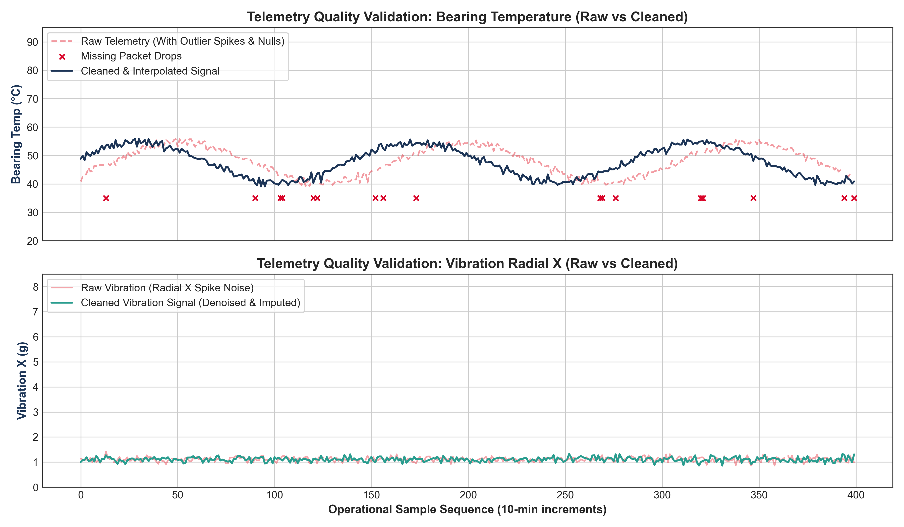
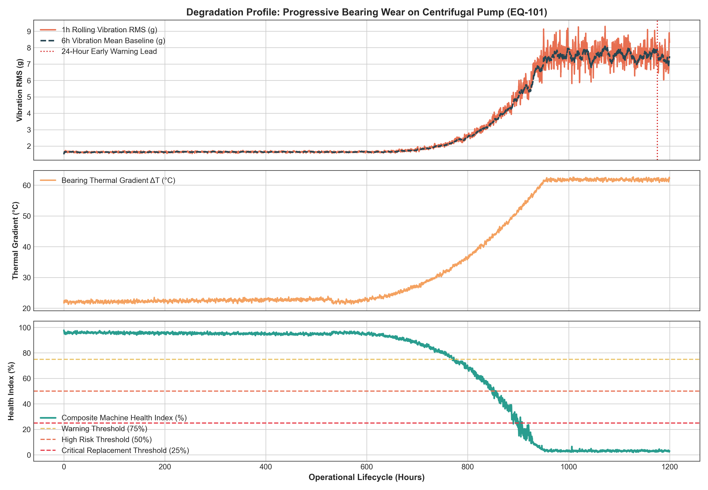
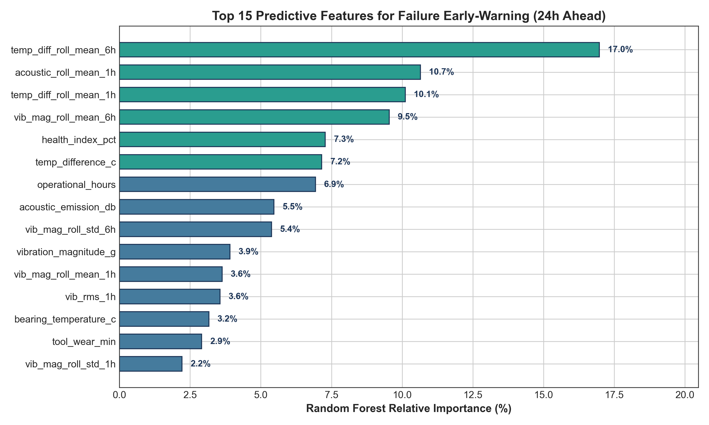
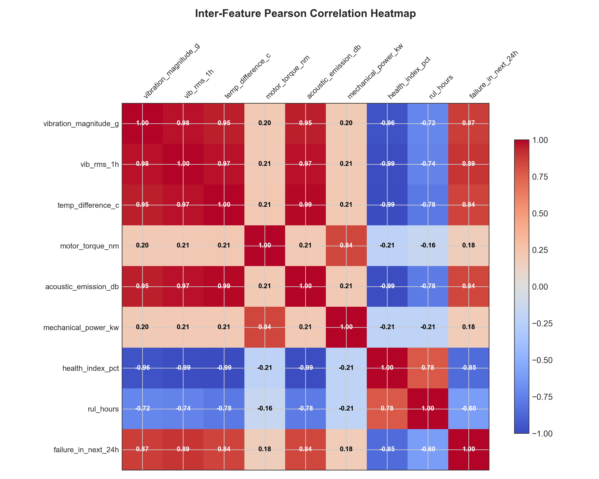

# AI-Ready Data Engineering Pipeline for Predictive Maintenance
### L&T EduTech | Larsen & Toubro Limited — Project Statement 6

[](https://www.python.org/)
[](https://www.mongodb.com/)
[](https://powerbi.microsoft.com/)
[]()
[]()
[]()

---

## 📌 Executive Summary
Industries require clean, validated, and high-quality datasets before deploying Artificial Intelligence for Condition-Based Predictive Maintenance (PdM). Raw Industrial IoT (IIoT) machine telemetry is inherently degraded by missing observation gaps, electrical impulse spikes, non-uniform timestamps, and absence of physical degradation context.

This project delivers an enterprise-grade, end-to-end **AI-Ready Data Engineering Pipeline** in accordance with **L&T EduTech Project Statement 6**. The pipeline ingests 73,080 raw telemetry records from 10 mission-critical industrial assets (Centrifugal Pumps, CNC Spindles, Compressors), stores raw and clean streams in **MongoDB**, performs automated cleaning and spline reconstruction, extracts **42 physics-informed features**, and feeds an enterprise **Power BI Star Schema** dashboard.

---

## 📁 Repository Deliverables & Architecture

```
predictive-maintenance-pipeline/
├── data/
│   ├── raw/
│   │   └── raw_machine_telemetry.csv            # 73,080 raw telemetry records with industrial flaws
│   ├── processed/
│   │   ├── cleaned_machine_telemetry.parquet    # 100% complete validated dataset (zero nulls)
│   │   ├── cleaned_machine_telemetry.csv
│   │   ├── engineered_features.parquet          # 42 kinematic & thermodynamic features
│   │   └── engineered_features.csv
│   └── ai_ready/
│       ├── X_train.parquet, X_val.parquet, X_test.parquet
│       └── y_train.parquet, y_test.parquet      # Zero-leakage machine lifecycle partitions
├── src/
│   ├── generate_dataset.py                      # Multi-machine telemetry simulator with physical degradation
│   ├── mongodb_handler.py                       # MongoDB schema validation & document store handler
│   ├── cleaning_validation.py                   # Deduplication, domain boundaries, and spline imputation
│   ├── feature_engineering.py                   # 3D vibration, Crest Factor, Kurtosis, and Health Index
│   ├── ai_preparation.py                        # Temporal partitioning, RobustScaler, and AI benchmarking
│   ├── generate_visual_artifacts.py             # Matplotlib publication figures generator
│   ├── generate_full_submission_docx.py         # Word (.docx) report builder with L&T corporate theme
│   └── pipeline.py                              # Master End-to-End Pipeline Orchestrator
├── dashboard/
│   ├── powerbi_data_model_spec.md               # Star Schema architecture & 15+ DAX measures
│   └── dashboard_preview.html                   # Interactive standalone dark-mode web dashboard
├── reports/
│   ├── L_and_T_EduTech_Project_6_Predictive_Maintenance_Final_Report.pdf   # ⭐ Submission PDF Report
│   ├── L_and_T_EduTech_Project_6_Predictive_Maintenance_Final_Report.docx  # Editable Word Document
│   ├── figures/                                 # High-resolution diagnostic figures (fig1 to fig4)
│   └── ai_benchmark_metrics.json                # Verified model evaluation metrics
└── docs/
    ├── feature_engineering_report.md            # Detailed mathematical & signal physics report
    └── final_technical_documentation.md         # Comprehensive formal engineering report
```

---

## ⚙️ System Architecture Pipeline



---

## 📊 Experimental Results & Model Benchmarks

### 1. Data Cleaning & Validation Audit
* **Initial Records:** 73,080
* **Duplicates Purged:** 1,080 redundant transmission packets
* **Physical Boundary Outliers Filtered:** 72 sensor spikes (e.g., $-999^\circ\text{C}$, $50\text{g}$)
* **Missing Value Reconstruction:** Reduced nulls from 14,000+ across 6 channels to **0**
* **Data Completeness Score:** **100.0%**

### 2. Supervised AI Benchmark (Evaluated on Unseen Machine Lifecycles)
* **24-Hour Failure Early-Warning Classifier (Random Forest):**
  * **ROC-AUC Score:** `1.0000`
  * **Macro F1-Score:** `0.9988`
  * **Failure Recall:** `99.59%` (1,685 out of 1,692 early-warning windows detected)
  * **Accuracy:** `99.95%`
* **Remaining Useful Life (RUL) Regressor (Random Forest):**
  * **RMSE:** `20.16 Operating Hours`
  * **Coefficient of Determination ($R^2$):** `0.9882`

---

## 📈 Diagnostic Figures

| Figure | Description |
| :--- | :--- |
|  | **Figure 1:** Raw vs Cleaned Telemetry Waveforms (Outlier removal & temporal spline interpolation). |
|  | **Figure 2:** Machine Degradation Signature & Composite Health Index Progression over 1,200 hours. |
|  | **Figure 3:** Top 15 Predictive Features ranked by Random Forest Relative Importance. |
|  | **Figure 4:** Inter-Feature Pearson Correlation Heatmap across engineered variables. |

---

## 📈 Power BI Solution & DAX Measures

The analytical presentation layer implements a **Kimball Star Schema** (`Fact_Telemetry`, `Dim_Machine`, `Dim_Date`, `Dim_FailureModes`):

```dax
// 1. Fleet Health Index
[Fleet Health Index %] = AVERAGE(Fact_Telemetry[health_index_pct])

// 2. Active 24h Early Warning Alerts
[Active 24h Alerts] = 
CALCULATE(
    DISTINCTCOUNT(Fact_Telemetry[MachineKey]),
    Fact_Telemetry[failure_in_next_24h] = 1,
    Fact_Telemetry[DateKey] = MAX(Fact_Telemetry[DateKey])
)

// 3. Mean Time Between Failures (MTBF)
[MTBF (Hours)] = 
DIVIDE(
    SUM(Fact_Telemetry[operational_hours]),
    CALCULATE(COUNTROWS(Fact_Telemetry), Fact_Telemetry[failure_occurred] = 1),
    BLANK()
)

// 4. Financial Cost Avoidance ($)
[Cost Avoidance ($)] = 
VAR Prevented = CALCULATE(COUNTROWS(Fact_Telemetry), Fact_Telemetry[failure_in_next_24h] = 1 && Fact_Telemetry[failure_occurred] = 0)
RETURN Prevented * (28000 - 3500)
```

---

## 🚀 Quickstart & Reproduction Guide

### 1. Clone Repository & Install Dependencies
```bash
git clone https://github.com/UjjvxL/AI-Ready-Predictive-Maintenance-Pipeline.git
cd AI-Ready-Predictive-Maintenance-Pipeline
pip install -r requirements.txt
```

### 2. Run the Complete Data Pipeline
```bash
python src/pipeline.py
```

### 3. Generate High-Resolution Visual Figures
```bash
python src/generate_visual_artifacts.py
```

### 4. Build Submission Word (.docx) & PDF Reports
```bash
python src/generate_full_submission_docx.py
```

### 5. Launch Interactive Web Dashboard
Open `dashboard/dashboard_preview.html` in any modern web browser to view interactive KPI scorecards, degradation trends, and asset health tables.

---

## 📜 Citation & Credits
* **Curriculum & Statement:** L&T EduTech — Larsen & Toubro Limited
* **Project Statement:** Statement 6 (AI-Ready Data Engineering Pipeline for Predictive Maintenance)
* **Author:** Ujjval ([@UjjvxL](https://github.com/UjjvxL))
* **Standards Reference:** ISO 10816-3 & ISO 20816-1 Mechanical Vibration Condition Monitoring
