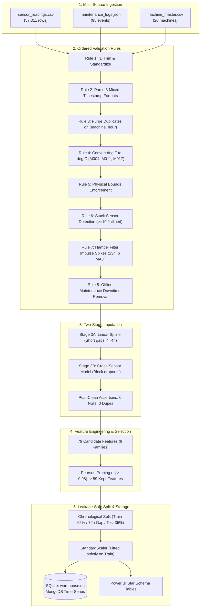

# AI-Ready Data Engineering Pipeline for Predictive Maintenance
### L&T EduTech | Larsen & Toubro Limited — Project Statement 6

[](https://www.python.org/)
[](https://www.sqlite.org/)
[](https://www.mongodb.com/)
[](https://powerbi.microsoft.com/)
[]()
[]()
[]()

---

## 📌 Executive Summary
Predictive maintenance AI is only as good as the data under it. Raw machine sensor data is rarely usable as delivered: sensors drop out, units differ between machines, timestamps arrive in multiple formats, and failures are recorded in separate enterprise systems.

In accordance with **L&T EduTech Project Statement 6**, this repository delivers an end-to-end, reproducible data engineering pipeline that turns messy multi-source industrial telemetry into a trustworthy, model-ready dataset, backed by a Power BI Star Schema and a comprehensive technical documentation report.

📄 **Download the Final Documentation Report (PDF):**  
[**`AI_Ready_Data_Engineering_Pipeline_Final_Documentation.pdf`**](reports/AI_Ready_Data_Engineering_Pipeline_Final_Documentation.pdf)

---

## 📁 Repository Structure & Deliverables

```
AI-Ready-Predictive-Maintenance-Pipeline/
├── data/
│   ├── raw/
│   │   ├── sensor_readings.csv          # 57,311 raw hourly readings across 20 machines with 7 defect classes
│   │   ├── maintenance_logs.json        # 95 semi-structured work orders (37 failures, 58 preventive)
│   │   └── machine_master.csv           # Asset register for 20 machines (pumps, compressors, motors, turbines)
│   ├── processed/
│   │   └── cleaned_sensor_data.csv      # 55,576 validated rows, 0 nulls, 0 duplicates, 0 out-of-range
│   ├── ai_ready_dataset.csv             # 54,159 rows x 59 engineered features with RUL and 72h targets
│   ├── ai_ready_dataset_scaled.csv      # Leakage-safe StandardScaler applied strictly to train partition
│   └── warehouse.db                     # Queryable SQLite warehouse (dim_machine, fact_maintenance, fact_sensor_clean)
├── src/
│   ├── generate_data.py                 # Multi-source simulator with realistic physics and injected defects
│   ├── pipeline.py                      # 8-rule validation, 2-stage imputation, 79->59 pruning, and warehouse ETL
│   ├── model_check.py                   # Random Forest benchmarks (Raw vs Engineered) & RUL regression
│   ├── dashboard.py                     # Exports Star Schema CSVs for Power BI and dashboard rendering
│   └── mongo_store.py                   # MongoDB document store with time-series collections & aggregation pipelines
├── powerbi/                             # Star Schema tables for Power BI Desktop
│   ├── dim_machine.csv
│   ├── fact_sensor_hourly.csv
│   ├── fact_sensor_daily.csv
│   ├── fact_maintenance.csv
│   ├── data_quality_scorecard.csv
│   ├── data_quality_issues.csv
│   └── feature_importance.csv
├── figures/                             # 13 high-resolution publication and dashboard figures
│   ├── fig01_pipeline_architecture.png
│   ├── fig02_temperature_cleaning_m004.png
│   ├── fig03_defects_by_category.png
│   ├── fig04_imputation_error_comparison.png
│   ├── fig05_correlation_matrix.png
│   ├── fig06_vibration_envelope.png
│   ├── fig07_rul_distribution.png
│   ├── fig08_top_predictive_features.png
│   ├── fig09_model_precision_recall_f1.png
│   ├── fig10_dashboard_page1_data_quality.png
│   ├── fig11_dashboard_page2_machine_health.png
│   ├── fig12_fleet_vibration_heatmap.png
│   └── fig13_machine_m001_sensor_trends.png
├── reports/
│   ├── AI_Ready_Data_Engineering_Pipeline_Final_Documentation.pdf   # ⭐ Final Submission PDF Report
│   ├── AI_Ready_Data_Engineering_Pipeline_Final_Documentation.docx  # Editable Submission Word Document
│   ├── pipeline_stats.json              # Traceable execution metrics
│   ├── imputation_evaluation.csv        # Hide-and-recover empirical imputation error benchmark
│   ├── feature_importance.csv           # Top predictive feature rankings
│   ├── feature_catalog.csv              # Full 79 candidate feature data dictionary
│   ├── model_baseline.json              # Model evaluation metrics
│   ├── scaler_params.json               # Train-set standardization parameters
│   └── pipeline.log                     # Step-by-step execution log
└── requirements.txt
```

---

## ⚙️ Pipeline Architecture



---

## 🧪 Experimental Validation & Benchmark Results

### 1. Data Cleaning & Defect Correction
* **Initial Raw Rows:** 57,311 across 20 machines over 120 operating days.
* **Unit Mix-Up Fix:** Detected and converted 8,533 temperature readings from Fahrenheit to Celsius on machines `M004`, `M011`, and `M017`.
* **Duplicates Purged:** 1,014 duplicate records dropped on `(machine_id, hour)`.
* **Sensor Outliers Blanked:** 7,375 physical range violations + 1,214 Hampel spikes + 68 flat-lined readings.
* **Data Quality Scorecard:**

| Dimension | Definition | Raw Feed | Cleaned Feed |
| :--- | :--- | :--- | :--- |
| **Completeness** | Share of sensor cells that are non-missing | 96.95% | **100.0%** |
| **Validity** | Share of cells free of range violations, spikes, stuck values, and unit errors | 97.03% | **100.0%** |
| **Uniqueness** | Share of rows that are not duplicates on (machine, hour) | 99.01% | **100.0%** |
| **Consistency** | Share of ID and timestamp fields in canonical form | 89.97% | **100.0%** |

### 2. Imputation Experiment: Hide-and-Recover Error
1,500 known sensor values were hidden and recovered using 5 imputation techniques (MAE comparison):

| Sensor | Gap Type | Global Mean | Machine Median | Forward Fill | Linear Interp. | Cross-Sensor Model |
| :--- | :--- | :--- | :--- | :--- | :--- | :--- |
| **Temperature** | Single points | 3.377 | 3.080 | 1.707 | 1.486 | **1.397** |
| **Temperature** | 12-hour blocks | 3.813 | 3.593 | 2.440 | 1.888 | **1.387** |
| **Vibration** | Single points | 0.677 | 0.589 | 0.288 | **0.258** | 0.290 |
| **Vibration** | 12-hour blocks | 0.751 | 0.658 | 0.333 | 0.313 | **0.289** |

*Finding:* Cross-sensor regression achieves 26% lower error than interpolation for multi-hour block dropouts by leveraging the remaining five operational sensors.

### 3. Supervised Model Readiness (Test Period Evaluation)

| Metric | Raw Sensors Only (6 Features) | Engineered Dataset (59 Features) |
| :--- | :--- | :--- |
| **ROC-AUC** | 0.9995 | **1.0000** |
| **PR-AUC** | 0.9675 | **0.9999** |
| **Precision** | 0.940 | **0.998** |
| **Recall** | 0.986 | **0.990** |
| **Macro F1-Score** | 0.962 | **0.994** |
| **RUL Error (MAE)** | 55.9 Hours (Naive Guess) | **28.0 Hours** |

---

## 📈 Power BI Data Model (Star Schema)

The analytical store implements a dimensional **Star Schema** in `powerbi/` with 1-to-many relationships:
* `dim_machine[machine_id]` ➔ `fact_sensor_hourly[machine_id]` (1 : *)
* `dim_machine[machine_id]` ➔ `fact_sensor_daily[machine_id]` (1 : *)
* `dim_machine[machine_id]` ➔ `fact_maintenance[machine_id]` (1 : *)
* `DimDate[Date]` ➔ `fact_sensor_daily[date]` (1 : *)

### Core Production DAX Measures
```dax
// 1. Average Fleet Vibration
Avg Vibration = AVERAGE ( fact_sensor_daily[avg_vibration] )

// 2. Machine Failure Count
Failure Count = 
CALCULATE ( 
    COUNTROWS ( fact_maintenance ), 
    fact_maintenance[event_type] = "FAILURE" 
)

// 3. Total Unscheduled Downtime Hours
Downtime Hours = 
CALCULATE ( 
    SUM ( fact_maintenance[downtime_hours] ), 
    fact_maintenance[event_type] = "FAILURE" 
)

// 4. Mean Time Between Failures (MTBF)
Operating Hours = SUM ( fact_sensor_daily[readings] )
MTBF (hours) = DIVIDE ( [Operating Hours], [Failure Count] )

// 5. Active High Risk Machines (72-Hour Horizon)
Machines At Risk = 
CALCULATE ( 
    DISTINCTCOUNT ( fact_sensor_daily[machine_id] ), 
    fact_sensor_daily[failure_risk_window] = 1 
)

// 6. Data Quality Imputed Cell Share %
Imputed Share % = 
DIVIDE ( 
    SUM ( fact_sensor_daily[imputed_cells] ), 
    SUM ( fact_sensor_daily[readings] ) * 6 
)
```

---

## 🚀 Quickstart & Reproduction Guide

### 1. Clone Repository & Install Dependencies
```bash
git clone https://github.com/UjjvxL/AI-Ready-Predictive-Maintenance-Pipeline.git
cd AI-Ready-Predictive-Maintenance-Pipeline
pip install -r requirements.txt
```

### 2. Generate Simulated Multi-Source Telemetry
```bash
python src/generate_data.py
```

### 3. Run the End-to-End Pipeline
Ingests sources, executes the 8 validation rules, runs two-stage imputation, prunes features, and generates `warehouse.db` and AI datasets:
```bash
python src/pipeline.py
```

### 4. Run Baseline AI Model Verification
```bash
python src/model_check.py
```

### 5. Export Power BI Star Schema Tables
```bash
python src/dashboard.py
```

---

## 📜 Citation & Academic Details
* **Organization:** Larsen & Toubro Limited — L&T EduTech
* **Project Statement:** Project Statement 6 (AI-Ready Data Engineering Pipeline for Predictive Maintenance)
* **Author:** Ujjval ([@UjjvxL](https://github.com/UjjvxL))
* **Standards Reference:** ISO 10816-3 & ISO 20816-1 Vibration Severity Standards
